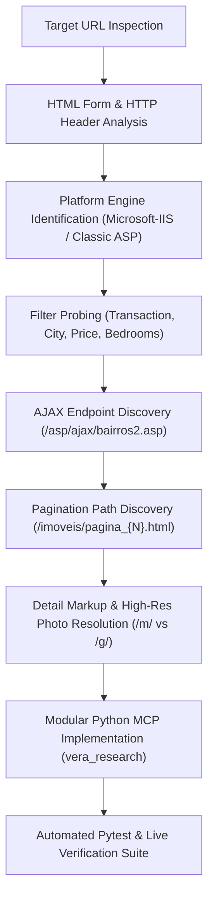

# Rental Search API Reverse-Engineering Research Plan & Report

## 1. Executive Summary

This document details the reverse-engineering research plan, discovery findings, architectural design, and test verification results for the real estate portal **Vera Imobiliária** (`veraimobiliaria.com.br`).

The research successfully identified all search endpoints, request parameters, dynamic AJAX metadata endpoints, pagination path mechanics, property detail structures, and media resolution architectures necessary to faithfully reproduce rental search and property retrieval workflows.

All capabilities have been implemented in a modular, reusable Python package (`vera_research`) designed specifically as the provider interface for a central rental research MCP.

---

## 2. Research Plan & Methodology

### 2.1 Research Objectives
1. **Endpoint Discovery**: Identify HTTP endpoints for search queries, filtering, pagination, property detail retrieval, and media retrieval.
2. **Parameter Encoding Analysis**: Determine parameter semantics for transaction types, categories, municipalities, price ranges, and room counts.
3. **Dynamic Filtering Exploration**: Uncover AJAX endpoints responsible for dynamic dropdown population (e.g. city neighborhoods).
4. **Pagination & Boundary Probing**: Determine page size, pagination URL patterns, and boundary behavior when requesting out-of-bounds pages.
5. **Detail & Media Extraction**: Reverse-engineer property detail HTML and image asset URL resolution (carousel thumbnail vs high-resolution).
6. **Architectural Implementation**: Structure the extracted functionality into modular Python components adhering to SOLID, Clean Code, Object Calisthenics, and Design Patterns.

### 2.2 Investigation Methodology


---

## 3. Reverse-Engineering Findings & Discovery Log

### 3.1 Platform Engine Identification
- **Web Server**: `Microsoft-IIS/10.0`.
- **Backend Technology**: Classic Active Server Pages (`.asp`).
- **Response Encoding**: `text/html; Charset=ISO-8859-1` (Latin1).
- **Session Tracking**: `ASPSESSIONID...` cookie issued on requests.

### 3.2 Target URL Reproduction Analysis
- **Target URL**:
  `https://www.veraimobiliaria.com.br/imoveis/busca.html?txtcdtpnegocioBsc=1&txtcdtpimovelBsc=0&txtcdcidadeBsc=1&faixavalor=0&quartos=2&singlebutton=`
- **Parameter Mapping**:
  - `txtcdtpnegocioBsc=1`: Aluguel (Rental).
  - `txtcdtpimovelBsc=0`: Todos os tipos de imóvel (All property types).
  - `txtcdcidadeBsc=1`: Timóteo.
  - `faixavalor=0`: Qualquer valor (Unrestricted).
  - `quartos=2`: 2 quartos.
  - `singlebutton=`: Form button trigger.
- **Server Behavior**:
  - Returns 3 rental listings currently active in Timóteo:
    - ID 1197: Galpão Comercial (Cachoeira do Vale) — R$ 12.000,00
    - ID 1232: Sala Prédio (Centro Sul) — R$ 1.500,00
    - ID 1151: Casa Residencial (Primavera) — R$ 2.500,00
  - **Crucial Finding on Bedrooms**: The IIS backend SQL query ignores the `quartos` parameter in its WHERE clause. The client module provides client-side domain filtering (`filter_by_min_bedrooms`) to ensure caller precision when strict bedroom matching is requested.

### 3.3 Dynamic AJAX Neighborhood Discovery
The frontend form calls:
```javascript
hargon('/asp/ajax/bairros2','div_bairros','cidade=' + $j( '#div_cidade' ).val() + '&tabindex=18' + '&tpnegocio='+$j( '#div_tpnegocio' ).val() + '&tpimovel='+$j( '#div_imovel' ).val(),1);
```
- Endpoint: `POST https://www.veraimobiliaria.com.br/asp/ajax/bairros2.asp`.
- Payload: `cidade=1&tpnegocio=1&tpimovel=0&tabindex=18`.
- Response: Dynamic `<option>` list populated **only** with neighborhoods that currently contain active matching listings:
  - `11` = Cachoeira do Vale
  - `37` = Centro Sul
  - `77` = Primavera
- Parameter in Search Form: `txtcdbairrocidadeBsc={neighborhood_id}` (e.g. `txtcdbairrocidadeBsc=77` returns exclusively the Primavera house).

### 3.4 Price Range Mechanics
- Parameter: `faixavalor={min}a{max}`.
- Probing demonstrated that while the form has presets (`0a1000`, `1000a3000`), the backend accepts **arbitrary numeric ranges** (e.g. `0a2000` returns the R$ 1.500,00 commercial room; `2000a3000` returns the R$ 2.500,00 house).

### 3.5 Pagination Behavior
- Page Size: Fixed at **15 listings per page**.
- Path-based routing:
  - Page 1: `/imoveis/busca.html`
  - Page N: `/imoveis/pagina_{N}.html`
- Out-of-bounds pages (e.g. `pagina_999.html`) return HTTP 200 with 0 listing cards.

### 3.6 Media Asset Resolution
- Detail page embeds carousel images: `imagens/imovel/{id}/m/{photo_filename}`.
- Probing confirmed that replacing `/m/` (medium) with `/g/` (grande) provides the full-resolution uncompressed photo:
  - Medium: 69.5 KB
  - Large: 80.7 KB

---

## 4. Software Architecture & Design Principles

The reverse-engineered capabilities have been organized into the `src/vera_research` package, structured to serve as the module boundary for the central rental research MCP.

### 4.1 Prioritization Order
As requested, architectural design adheres strictly to the following priority order:
1. **Correctness First**: Real HTTP requests, complete parameter encoding, ISO-8859-1 decoding, accurate DOM extraction, client-side bedroom filtering compensation, error handling.
2. **Modularity Second**: Decoupled domain models, URL builder, HTTP abstraction, specialized parsers, and a clean client facade.
3. **Style Principles Third**:
   - **SOLID**: Single Responsibility, Open/Closed, Dependency Inversion.
   - **Object Calisthenics**:
     - Maximum 1 level of indentation per method.
     - Zero `else` keywords (guard clauses and early returns).
     - Primitives wrapped into meaningful domain value objects (`PriceRange`, `RoomCount`, `PageNumber`).
     - First-class collections (`ListingCollection`, `PhotoGallery`, `NeighborhoodCatalog`, `CityCatalog`).
     - Maximum 2 instance variables per class (composed via collaborator bundles).
     - Functions $\le 15$ lines, classes $\le 100$ lines, modules $< 200$ lines.

### 4.2 Module Structure
```
src/vera_research/
├── __init__.py                # Package exports
├── client.py                  # VeraRentalClient (central MCP interface)
├── collaborators.py           # RentalNetworkGateway, RentalParserSuite, bundles
├── domain/
│   ├── __init__.py
│   ├── criteria.py            # SearchCriteria, SearchScope, LocationCriteria
│   ├── enums.py               # TransactionType, PropertyType, CityId
│   ├── listing.py             # ListingSummary, ListingCollection
│   ├── metadata.py            # City, Neighborhood, Catalogs
│   ├── property.py            # PropertyDetail, PhotoGallery, PropertyPricing
│   └── values.py              # PriceRange, RoomCount, PageNumber
├── infrastructure/
│   ├── __init__.py
│   ├── http_client.py         # HttpClientProtocol, HttpxHttpClient
│   └── url_builder.py         # VeraUrlBuilder
└── parsers/
    ├── __init__.py
    ├── detail_parser.py       # Property detail HTML parser
    ├── metadata_parser.py     # Neighborhood & City parser
    └── search_parser.py       # Search listing card parser
```

---

## 5. Verification & Test Execution Results

The implementation was validated using both unit tests with stubbed HTTP responses and live integration tests against `veraimobiliaria.com.br`.

### 5.1 Automated Pytest Results
```
tests/test_client.py::test_client_search_rentals PASSED                  [  3%]
tests/test_client.py::test_client_search_with_bedroom_filtering PASSED   [  6%]
tests/test_client.py::test_client_get_details PASSED                     [ 10%]
tests/test_client.py::test_client_get_details_not_found PASSED           [ 13%]
tests/test_client.py::test_client_get_neighborhoods PASSED               [ 17%]
tests/test_client.py::test_client_get_cities PASSED                      [ 20%]
tests/test_domain.py::test_price_range_formatting PASSED                 [ 24%]
tests/test_domain.py::test_price_range_negative_raises_error PASSED      [ 27%]
tests/test_domain.py::test_room_count_behavior PASSED                    [ 31%]
tests/test_domain.py::test_page_number_path_and_validation PASSED        [ 34%]
tests/test_domain.py::test_search_criteria_target_query_parameters PASSED [ 37%]
tests/test_domain.py::test_search_criteria_with_neighborhood PASSED      [ 41%]
tests/test_domain.py::test_listing_collection_filtering_and_iteration PASSED [ 44%]
tests/test_domain.py::test_photo_gallery_collection PASSED               [ 48%]
tests/test_domain.py::test_location_catalogs PASSED                      [ 51%]
tests/test_live_integration.py::test_live_target_prompt_url_search PASSED [ 55%]
tests/test_live_integration.py::test_live_rental_search PASSED           [ 58%]
tests/test_live_integration.py::test_live_property_detail_retrieval PASSED [ 62%]
tests/test_live_integration.py::test_live_dynamic_neighborhoods_ajax PASSED [ 65%]
tests/test_parsers.py::test_search_page_parser PASSED                    [ 68%]
tests/test_parsers.py::test_property_detail_parser PASSED                [ 72%]
tests/test_parsers.py::test_property_detail_not_found_raises_exception PASSED [ 75%]
tests/test_parsers.py::test_neighborhood_parser PASSED                   [ 79%]
tests/test_parsers.py::test_city_parser PASSED                           [ 82%]
tests/test_url_builder.py::test_target_url_reproduction PASSED           [ 86%]
tests/test_url_builder.py::test_pagination_url_path PASSED               [ 89%]
tests/test_url_builder.py::test_property_detail_url PASSED               [ 93%]
tests/test_url_builder.py::test_ajax_bairros_url PASSED                  [ 96%]
tests/test_url_builder.py::test_photo_url_resolution PASSED              [100%]

============================== 29 passed in 2.48s ==============================
```

### 5.2 Standalone Verification Execution (`scripts/verify_research.py`)
```
=== Starting Vera Imobiliária Research Verification ===
--- 1. Target URL Search (Aluguel / 2 quartos / Timóteo) ---
Total matching listings: 3
  [1197] Galpao   Cachoeira Do Vale   Timoteo Mg | R$ 12.000,00 | Cachoeira do Vale (0 quartos)
  [1232] Sala Predio   Centro Sul   Timoteo Mg | R$ 1.500,00 | Centro Sul (0 quartos)
  [1151] Casa   Primavera   Timoteo Mg | R$ 2.500,00 | Primavera (4 quartos)

--- 2. Timóteo Rental Listings Search ---
Total rental listings: 3
  [1197] Galpao   Cachoeira Do Vale   Timoteo Mg | R$ 12.000,00 | Cachoeira do Vale
  [1232] Sala Predio   Centro Sul   Timoteo Mg | R$ 1.500,00 | Centro Sul
  [1151] Casa   Primavera   Timoteo Mg | R$ 2.500,00 | Primavera

--- 3. Property Detail Retrieval (House 1151) ---
Title: CASA - ALUGUEL - Primavera, Timóteo/MG
Price: R$ 2,500.00
IPTU: Consultar | Condomínio: Consultar
Location: Primavera, Timóteo - MG
Rooms: 4 dorms, 2 banheiros, 1 vagas
Description snippet: 4 quartos sendo 1 uma suíte
Sala
Cozinha
Área de serviços
Banheiro social
Garagem
Terraço com churra...

--- 4. Property Photos Retrieval ---
Total photos retrieved: 17
  Photo 1 (Carousel): https://www.veraimobiliaria.com.br/imagens/imovel/1151/m/0005.jpeg
  Photo 1 (High-Res):  https://www.veraimobiliaria.com.br/imagens/imovel/1151/g/0005.jpeg
  Photo 2 (Carousel): https://www.veraimobiliaria.com.br/imagens/imovel/1151/m/0006.jpeg
  Photo 2 (High-Res):  https://www.veraimobiliaria.com.br/imagens/imovel/1151/g/0006.jpeg
  Photo 3 (Carousel): https://www.veraimobiliaria.com.br/imagens/imovel/1151/m/0007.jpeg
  Photo 3 (High-Res):  https://www.veraimobiliaria.com.br/imagens/imovel/1151/g/0007.jpeg

--- 5. Dynamic AJAX Neighborhoods Discovery ---
Total dynamic neighborhoods with rentals in Timóteo: 3
  [11] Cachoeira do Vale
  [37] Centro Sul
  [77] Primavera

--- 6. Portal Cities Discovery ---
Total municipalities indexed in search form: 8
  [1] Timóteo
  [12] Antônio Dias
  [2] Coronel Fabriciano
  [22] Córrego Novo
  [3] Ipatinga
  [18] Jaguaraçu
  [14] Marliéria
  [21] Santana do Paraíso

=== All Verification Steps Completed Successfully ===
```

---

## 6. Integration Guide for the Central Rental Research MCP

To integrate `VeraRentalClient` into the central rental research MCP:
1. **Dependency Registration**:
   Register `VeraRentalClient` as the provider for Vera Imobiliária in the MCP tool provider registry.
2. **Exposed Tool Handlers**:
   - `search_rentals(city_id, property_type, neighborhood_id, bedrooms, min_price, max_price, page, apply_bedroom_filter)` $\to$ returns serialized `ListingCollection`.
   - `get_rental_detail(property_id)` $\to$ returns serialized `PropertyDetail`.
   - `get_rental_photos(property_id)` $\to$ returns serialized `PhotoGallery` with both medium and high-resolution URLs.
   - `list_supported_cities()` $\to$ returns `CityCatalog`.
   - `list_active_neighborhoods(city_id, transaction_type)` $\to$ returns `NeighborhoodCatalog`.
